# ReclaimAI — Autonomous Consumer Rights & Dispute Redressal Bureau


[](https://www.python.org/downloads/)
[](https://fetch.ai/)
[](https://asi1.ai/)
[](https://fetch.ai/)

> **Fetch-A-Thon 3.0 (India)** — *ASI:One Agent Challenge: From Intent to Action*  
> **Tagline**: Turning Indian consumer grievances into researched, cited, and dispatched legal notices with autonomous regulatory escalation and on-chain FET tracking.

---

## 📑 Table of Contents
1. [The Real-World Problem](#-the-real-world-problem)
2. [The Solution: ReclaimAI](#-the-solution-reclaimai)
3. [End-to-End System Architecture](#-end-to-end-system-architecture)
4. [5-Agent Multi-Agent Bureau](#-5-agent-multi-agent-bureau)
5. [Complete Workflow Sequence Diagram](#-complete-workflow-sequence-diagram)
6. [ASI:One Interactive Cards Showcase](#-asione-interactive-cards-showcase)
7. [Fetch.ai On-Chain Payment Protocol](#-fetchai-on-chain-payment-protocol)
8. [Interactive Commands & Decision Loop](#-interactive-commands--decision-loop)
9. [Quick Start & Local Execution](#-quick-start--local-execution)
10. [Honest Transparency: Real vs. Simulated Matrix](#-honest-transparency-real-vs-simulated-matrix)
11. [Verified Indian Statutory Corpus](#-verified-indian-statutory-corpus)
12. [Hackathon Evaluation Checklist](#-hackathon-evaluation-checklist)

---

## 🚨 The Real-World Problem

Every year, millions of Indian consumers lose thousands of crores to:
- **E-Commerce Giants**: Arbitrary refund rejections for broken or missing items citing delivery checklists.
- **Airlines**: Refusal to credit flight cancellation refunds within statutory windows.
- **Banking & UPI**: Unresolved payment gateway failures and unauthorized card debits.

### Why Existing AI Fails
General-purpose chatbots (ChatGPT, Claude) only generate **passive text templates**. They leave the consumer stranded:
- Consumers do not know the **official statutory Grievance Officer** or escalation portal.
- Notices lack **legally verified section citations** (e.g., confusing Rule 4(4) with Rule 5(4)).
- Chatbots cannot **dispatch** emails, verify **on-chain transactions**, or **autonomously follow up** when companies stall.

---

## 💡 The Solution: ReclaimAI

**ReclaimAI** is an autonomous 5-agent Fetch.ai Bureau that turns consumer intent into legally binding, dispatched action directly inside **ASI:One**.

- **Zero Custom Frontend Required**: The entire consumer journey occurs inside the ASI:One conversation interface using **Predefined Interactive Cards v1**.
- **Verified Statutory Citations**: Strictly grounded in official Government of India gazettes (Consumer Protection Act 2019, E-Commerce Rules 2020, DGCA CAR, RBI Ombudsman).
- **Sub-15s Response Time**: Employs **Speculative Background Pre-Drafting** so legal notice review cards appear in **<0.1 seconds**.
- **Real Dispatch & Escalation**: Emails notices directly to grievance channels via Resend API and autonomously escalates to the **National Consumer Helpline (NCH)** and **e-Daakhil** if statutory deadlines expire.
- **On-Chain Monetization**: Native Fetch.ai Payment Protocol seller role verified on **Fetch.ai Testnet** using `cosmpy`.

---

## 🏗️ End-to-End System Architecture

```
                                  +-----------------------------+
                                  |           ASI:One           |
                                  |   (Consumer Chat Session)   |
                                  +--------------+--------------+
                                                 |
                                      Agent Chat Protocol (ACP)
                                                 |
                                                 v
                                    +-------------------------+
                                    |     CONCIERGE AGENT     |
                                    |  (Interactive Card UI   |
                                    |   & Payment Protocol)   |
                                    +----+--------+---------+-+
                                         |        |         |
                          ResearchRequest|        |         |DraftRequest
                                         v        |         v
                         +---------------+--+     |     +---+---------------+
                         | RESEARCHER AGENT |     |     |   DRAFTER AGENT   |
                         | (Verified Indian |     |     | (ASI:One LLM      |
                         |  Statutory Laws) |     |     |  Legal Notices)   |
                         +------------------+     |     +-------------------+
                                                  |
                                   DispatchRequest|
                                                  v
                                    +-------------------------+
                                    |    DISPATCHER AGENT     |
                                    |   (Resend API / Email)  |
                                    +------------+------------+
                                                 |
                                   Notice Served | Cases.db
                                                 v
                                    +-------------------------+
                                    |      WATCHER AGENT      |
                                    | (Autonomous @on_interval|
                                    |   Deadlines -> Escalate)|
                                    +-------------------------+
```

### State Machine Lifecycle
```
[INTAKE] ──(Form Card)──> [RESEARCHING] ──(Detail Card)──> [DRAFT_REVIEW] ──(Review Card)──> [SENT] ──> [WAITING]
                                                                                                        │
                                                                       (Deadline Expired: Autonomous)   │
                                                                                                        v
                                                                                                  [ESCALATED] (Tier 2 NCH/e-Daakhil)
```

---

## 🤖 5-Agent Multi-Agent Bureau

All five agents run on **Fetch.ai Testnet** with deterministic cryptographic seeds, registered mailboxes on **Agentverse**, and full **Agent Chat Protocol (ACP)** compliance:

| Agent Name | Role & Responsibility | Deterministic Address | Network |
| :--- | :--- | :--- | :--- |
| **ReclaimAI Concierge** | Primary ASI:One orchestrator, intent classifier, Interactive Card manager, speculative pre-drafting coordinator, Payment Protocol seller. | `agent1q2a0f0a8zyw3229agt7saxtvenftxwe0gry6nv02dzd78rvye98tzty77e7` | Fetch.ai Testnet |
| **ReclaimAI Researcher** | Indian consumer law retrieval (CPA 2019, E-Commerce Rules 2020, DGCA CAR, RBI Ombudsman) and verified Grievance Officer nodal contact lookup. | `agent1qgktn2gauj62w4uaynnapajvsexxjgxuq8ylj6ru2503p9hxt09h6tcgaum` | Fetch.ai Testnet |
| **ReclaimAI Drafter** | High-precision legal notice drafting using `asi1-mini` via ASI:One LLM API; zero-placeholder enforcement and automatic date/party injection. | `agent1q00z4x9d574zttujnjwkj7zz7u0elv4jw4exrrefvqegjnz0dntu5cj5js0` | Fetch.ai Testnet |
| **ReclaimAI Dispatcher** | Safe outbound email transmission to verified company channels via Resend API with structured proof-of-delivery logging and demo redirect protection. | `agent1qg9evq8equ7kkt2nw8fkg2wgujr6sy69ucpeflyr28539rnx8v7ng2wuu8l` | Fetch.ai Testnet |
| **ReclaimAI Watcher** | Autonomous interval-based surveillance (`@on_interval`); monitors statutory deadlines in `cases.db` and dispatches Tier-2 regulatory escalations without human intervention. | `agent1qgz54hf8dzdvqsuf3ja9vfvdl25d9umed0r6y6vhalwtl2s0vqkmw3l0a46` | Fetch.ai Testnet |

---

## 🔄 Complete Workflow Sequence Diagram

```mermaid
sequenceDiagram
    autonumber
    actor User as Consumer (ASI:One)
    participant C as Concierge Agent
    participant R as Researcher Agent
    participant D as Drafter Agent
    participant S as Dispatcher Agent
    participant W as Escalation Watcher
    participant DB as SQLite (cases.db)
    participant E as Company Grievance Channel

    User->>C: Submit dispute in natural language (ACP)
    C->>User: Render Interactive Form Card (pre-filled)
    User->>C: Submit Form ("Verify & Research Rights")
    C->>R: ResearchRequest(category, company)
    R-->>C: ResearchResult(citations, grievance_officer, source_url)
    
    par Speculative Background Pre-Drafting
        C->>D: DraftRequest(facts, citations)
        D-->>C: DraftResult(letter_text) [Cached <0.1s]
    and Interactive Detail Card
        C->>User: Render Legal Rights Detail Card (Rule 4(4) & 4(5))
    end
    
    User->>C: Click "Draft Formal Grievance Notice"
    C->>User: Instant Review Card (<0.1s render, zero placeholders)
    User->>C: Click "Approve & Send Notice"
    C->>S: DispatchRequest(to, notice_body)
    S->>E: Send Email Notice via Resend API
    S-->>C: DispatchResult(msg_id, ok=true)
    C->>DB: Save Case (status="WAITING", deadline_at)
    C->>User: Confirmation Message + Proof-of-Delivery ID
    
    rect rgb(20, 25, 40)
    note over W,DB: Autonomous Interval Tracking (@on_interval)
    W->>DB: Poll for expired deadlines
    DB-->>W: Case #REC-... (Company failed to resolve in statutory window)
    W->>D: DraftRequest (Tier-2 Regulatory Petition)
    D-->>W: Tier-2 Escalation Notice (NCH & e-Daakhil)
    W->>S: DispatchRequest (Tier-2 Regulatory Escalation)
    S->>E: Dispatch Tier-2 Escalation Notice
    W->>DB: Update Case Status -> ESCALATED (Tier 2)
    end
```



---

## 🃏 ASI:One Interactive Cards Showcase

ReclaimAI is fully compliant with the **ASI:One Predefined Card Schemas v1**, using structured interactive cards at every step:

```
┌─────────────────────────────────────────────────────────────┐
│ 1. INTAKE FORM CARD (kind: "form")                          │
│ Pre-filled with entities extracted by ASI:One LLM:          │
│ • Company: Flipkart           • Claim Amount: ₹24,999       │
│ • Complainant: Ashiq          • Email: ash@example.com      │
│ [ Button: Verify & Research Rights ]                        │
└─────────────────────────────────────────────────────────────┘
                              │
                              ▼
┌─────────────────────────────────────────────────────────────┐
│ 2. LEGAL RIGHTS DETAIL CARD (kind: "detail")                │
│ Verified Indian Statutory Protections & Deadlines:          │
│ • Rule 4(4): Mandatory Grievance Redressal Mechanism        │
│ • Rule 4(5): Mandatory 48h Ack & 30-day Resolution Window   │
│ • Verified Contact: grievance.officer@flipkart.com          │
│ • Official Source: https://www.flipkart.com/pages/grievance │
│ [ Button: Draft Formal Grievance Notice ]                   │
└─────────────────────────────────────────────────────────────┘
                              │ (Rendered in <0.1s via pre-draft)
                              ▼
┌─────────────────────────────────────────────────────────────┐
│ 3. NOTICE REVIEW CARD (kind: "review")                      │
│ High-precision legal notice citing CPA 2019:                │
│ • Date: 24 October 2026 (Auto-injected current date)        │
│ • Zero "[...]" placeholder brackets guaranteed              │
│ • Warning of impending CCPA / e-Daakhil filing              │
│ [ Primary: Approve & Send Notice ]   [ Secondary: Edit ]    │
└─────────────────────────────────────────────────────────────┘
                              │
                              ▼
┌─────────────────────────────────────────────────────────────┐
│ 4. TIMELINE CAROUSEL CARD (kind: "carousel" via /status)    │
│ Multi-card chronological audit trail from cases.db:         │
│ [Card 1: Intake] ──> [Card 2: Dispatch] ──> [Card 3: Escalate]
└─────────────────────────────────────────────────────────────┘
```

---

## 💳 Fetch.ai On-Chain Payment Protocol

ReclaimAI implements the official Fetch.ai `payment_protocol_spec` with `role="seller"`:

- **Free Tier Invariant**: Dispute intake, statutory research, grievance officer lookup, formal notice drafting, and initial Tier-1 dispatch are **100% free**.
- **Auto-Escalation & Tracking Pack**: Users can opt in to autonomous 24/7 regulatory surveillance and Tier-2 escalation for **0.001 FET** on testnet.
- **Strict Ledger Verification**:
  1. Concierge issues `RequestPayment(accepted_funds=[0.001 FET], recipient=...)`.
  2. Buyer submits `CommitPayment(transaction_id=...)`.
  3. Concierge queries the Fetch.ai Testnet ledger using `cosmpy.aerial.client.LedgerClient`.
  4. Only upon confirmed on-chain settlement is `CompletePayment` returned and `tracking_paid=1` flagged in `cases.db`. Fraudulent or unconfirmed hashes are strictly rejected.

---

## 🧠 Interactive Commands & Decision Loop

In addition to guided card flows, ReclaimAI provides powerful command capabilities:

- **`/reply <company email text>`**:
  When a company replies, the user pastes the reply into chat. The Concierge classifies the intent (`resolved`, `rejected`, `stalling`, `needs_info`):
  - If `rejected`: Autonomously drafts an assertive legal rebuttal citing unfair trade practice sections and presents a Review Card.
  - If `stalling`: Issues a statutory warning of immediate CCPA escalation.
- **`/edaakhil`**:
  Generates a ready-to-file formal consumer commission petition packet with pecuniary jurisdiction analysis (District Commission <= ₹50 Lakhs under 2021 Rules).
- **`/status`**:
  Renders the live chronological event audit trail Carousel Card.
- **`/health`**:
  Displays real-time operational status, mailbox connectivity, and memory metrics across all five agents.
- **`/ping`**:
  Instant lightweight heartbeat (`<0.1s`).

---

## ⚡ Quick Start & Local Execution

### 1. Prerequisites
- Linux / macOS
- Python 3.11 (`python3.11` recommended)
- Git

### 2. Installation
```bash
git clone https://github.com/MohamedAshiq09/reclaim-ai.git
cd reclaim-ai

# Set up virtual environment
python3.11 -m venv .venv
source .venv/bin/activate

# Install dependencies
pip install -r requirements.txt
```

### 3. Environment Configuration
Copy `.env.example` to `.env`:
```bash
cp .env.example .env
```
Key configuration values:
```bash
AGENTVERSE_API_KEY=your_key_here         # Agentverse mailbox registration
ASI_ONE_API_KEY=your_key_here            # ASI:One LLM API key
ASI_ONE_MODEL=asi1-mini                  # Optimized 3x faster response model
RESEND_API_KEY=your_key_here             # Resend email API key
DEMO_MODE=1                              # Demo routing (accelerates deadlines to 2 mins)
DEMO_RECIPIENT_OVERRIDE=your@email.com   # Safe recipient for test notices
FET_USE_TESTNET=true                     # Fetch.ai testnet on-chain settlement
FET_PAYMENT_AMOUNT=0.001                 # Price in FET
```

### 4. Automated Testing Gate
Run the complete offline pytest suite (26 passing unit and flow tests):
```bash
TESTING=1 PYTHONPATH=. .venv/bin/pytest tests/ -q
```

### 5. Launch the 5-Agent Bureau
Start all five agents concurrently in a single orchestrated Bureau:
```bash
.venv/bin/python run_bureau.py
```
*Follow the live structured audit stream in another terminal:*
```bash
tail -f logs/live.log
```

### 6. Interactive Demos & Drills
- **Terminal Demo (Payment Protocol & Autonomous Escalation)**:
  ```bash
  .venv/bin/python scripts/demo_terminal_step.py
  ```
- **Autonomous Buyer Agent (Machine-to-Machine FET Settlement)**:
  ```bash
  .venv/bin/python scripts/run_buyer_agent.py
  ```
- **Failure Resilience Drill (Search Outage, Email Outage, Payment Fraud)**:
  ```bash
  TESTING=1 .venv/bin/python scripts/failure_drill.py
  ```

---

## 🔍 Honest Transparency: Real vs. Simulated Matrix

In compliance with hackathon evaluation standards, ReclaimAI explicitly declares the operational status of every subsystem:

| Feature / Subsystem | Status | Implementation Details & Gating |
| :--- | :--- | :--- |
| **Agentverse Discovery & Mailboxes** | **REAL** | All 5 agents registered on Agentverse and actively polling via Mailbox API (HTTP 200). |
| **ASI:One Interactive Cards** | **REAL** | ACP v1 Predefined Cards (`form`, `detail`, `review`, `carousel`) rendered live in ASI:One chat. |
| **ASI:One LLM Reasoning & Drafting** | **REAL** | Powered by `api.asi1.ai/v1` (`asi1-mini` for <7s execution); protected with client timeouts and fallback templates. |
| **Statutory Law Citations** | **REAL** | 100% verified against official Government of India gazettes (CPA 2019, E-Commerce Rules 2020, DGCA CAR, RBI Ombudsman). |
| **Email Notice Dispatch** | **HYBRID** | When `RESEND_API_KEY` is present, transmits live transactional emails to `DEMO_RECIPIENT_OVERRIDE`. Gracefully falls back to simulated dispatch if unset. |
| **Enterprise Grievance Contacts** | **HYBRID** | Curated registry of official nodal officer contacts with verified direct portal links. |
| **Autonomous Watcher Escalation** | **REAL** | Background `@on_interval` surveillance loop queries `cases.db` deadlines and triggers automated Tier-2 escalation upon expiration. |
| **Payment Protocol Verification** | **STRICT ON-CHAIN** | Native FET seller flow verified strictly on Fetch.ai testnet ledger via `cosmpy`. Offline bypass is strictly prohibited without explicit `DEMO_PAYMENT_BYPASS=1`. |

---

## 📚 Verified Indian Statutory Corpus

All legal citations in ReclaimAI have been rigorously checked against official government sources:

1. **Consumer Protection (E-Commerce) Rules, 2020**:
   - **Rule 4(4)**: Mandatory appointment of a Grievance Officer and grievance redressal mechanism.
   - **Rule 4(5)**: Mandatory 48-hour acknowledgment and 30-day final dispute resolution.
2. **Consumer Protection Act, 2019**:
   - **Section 2(9)**: Consumer rights to redressal against unfair trade practices.
   - **Section 2(11) & Section 2(47)**: Deficiency of service and unfair trade practices (unilateral return rejections).
   - **Section 35**: Direct electronic petition filing via the e-Daakhil portal.
3. **Consumer Commission Pecuniary Jurisdiction (Rules 2021 - G.S.R. 886(E))**:
   - District Commission: Claims up to ₹50 Lakhs.
   - State Commission: Claims from ₹50 Lakhs to ₹2 Crores.
4. **DGCA Civil Aviation Requirements (CAR Section 3, Series M)**:
   - **Part II (Para 3.3)**: 7-day refund for credit card cancellations directly to bank account; 14 working days for travel agents.
   - **Part IV**: Mandatory refreshments and statutory compensation (₹5,000–₹10,000) for unnotified flight delays/cancellations.
5. **Reserve Bank Integrated Ombudsman Scheme (RB-IOS 2021)**:
   - **Clause 10 & Clause 15**: 30-day mandatory bank redressal window followed by CMS portal escalation with compensation up to ₹20 Lakhs.

---

## 🏆 Hackathon Evaluation Checklist

- [x] **5 Registered uAgents**: All 5 agents registered on Agentverse with active mailboxes.
- [x] **Agent Chat Protocol (ACP)**: Implements official `ChatMessage`, `ChatAcknowledgement`, and card metadata.
- [x] **ASI:One Interactive Cards**: Form, Detail, Review, and Carousel schemas utilized seamlessly.
- [x] **Native Fetch.ai Payment Protocol**: `payment_protocol_spec` with `cosmpy` testnet verification.
- [x] **Real-World Impact**: Protects Indian consumers with verified statutory rights and automated action.
- [x] **Zero Synthetic User Traffic**: Pure organic interactions; initial technical diagnostic testing envelopes fully documented in `anchor.md`.
- [x] **Production Grade**: 26 automated unit/integration tests passing offline; zero-placeholder guarantee; resilient failovers.

---

**Built with ❤️ for Fetch-A-Thon 3.0 (India) by Mohamed Ashiq**
